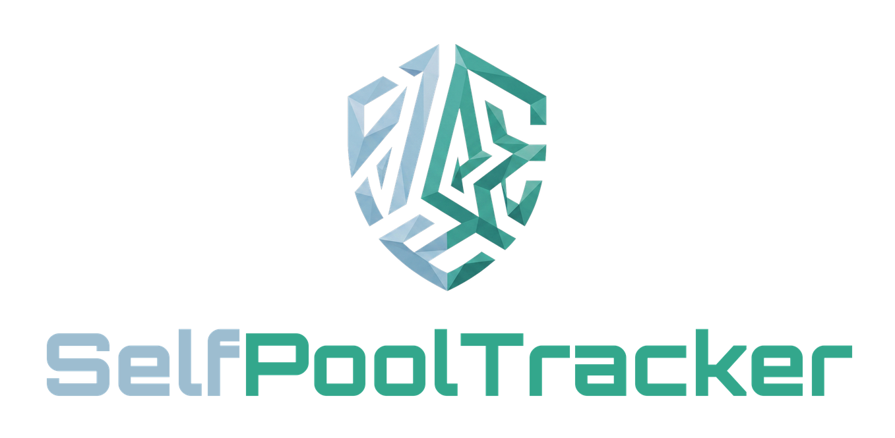

<div align="center">



**Pool water-quality tracker that runs entirely in your browser — pH, chlorine, redox & temperature logging with traffic-light status and dosing recommendations. No server, no cloud, no account.**<br>
*Pool-Wasserwerte direkt im Browser tracken — pH, Chlor, Redox & Temperatur mit Ampel-Status und Dosierempfehlung. Kein Server, keine Cloud, kein Konto.*

[](https://pool.selfcoder.de)


**[🇬🇧 English](#-english) · [🇩🇪 Deutsch](#-deutsch)**

📰 **What's new / Neuigkeiten** → [CHANGELOG.md](CHANGELOG.md)

</div>

---

<a id="-english"></a>

## 🇬🇧 English

SelfPoolTracker is a single-file web app for keeping your pool chemistry in check. Open one HTML file in Chrome or Edge (or just visit **[pool.selfcoder.de](https://pool.selfcoder.de)**), enter your pool dimensions and log your measurements — every value gets a green / yellow / red status and a concrete dosing recommendation based on your pool volume. It is **not** a cloud service: there is no server and no account, and your data never leaves your device.

Part of the **Self** family (SelfMailer, SelfStream, SelfArchiver, SelfDashboard …) — same design system; deployed as a static site on GitHub Pages instead of GHCR → Unraid.

> **TL;DR** — pH · chlorine · redox · temperature · traffic-light status · dosing calculator · circulation calculator · 12 languages · local storage only · Android app.

### 📑 Table of contents

[Features](#en-features) · [Usage](#en-usage) · [Data storage](#en-data-storage) · [Ideal values](#en-ideal-values) · [Quick start](#en-quick-start) · [Android app](#en-android) · [Security](#en-security) · [Tech stack](#en-tech-stack) · [Development](#en-development) · [Roadmap](#en-roadmap)

<a id="en-features"></a>

### ✨ Features

**🏊 Pool & measurements**
- **Pool volume calculator** — oval, round and rectangular pools with automatic shape-based labels
- **Daily measurement log** — pH, free chlorine, redox (mV), temperature, date & time
- **Automatic status** — green / yellow / red traffic light for every value

**🧪 Calculators**
- **Dosing recommendations** — pH-Minus, pH-Plus and quick-chlorine amounts calculated from your pool volume
- **Dosing calculator** — standalone calculator for any manual adjustment, incl. shock chlorination
- **Circulation calculator** — pump flow rate (m³/h) → time for one turnover, recommended runtime (2× a day), temperature rule (temp ÷ 2) and minimum pump rate (2× in 8 h)

**💾 Data**
- **File-based storage** — data saved to a local JSON file (no cloud, no cache loss) with `localStorage` fallback
- **Backup & import** — export and re-import your full dataset (pool config + measurements) as a single JSON file; device-independent and works in any browser, including Android
- **CSV export** — export your full measurement history

**🔐 Security & platform**
- **12 languages** (de, en, fr, es, it, nl, pl, pt, sv, da, cs, el) via dropdown, browser language detected on first start
- **No server, no account** — everything runs in the browser
- **Self brand** — dark theme, teal accent, Exo 2 + IBM Plex Mono, Orbitron wordmark

<a id="en-usage"></a>

### 📝 Usage

1. Open `index.html` in **Chrome** or **Edge** (the File System Access API is required for file storage)
2. Set your pool dimensions → volume is calculated automatically
3. Click **📂 Open / create file** to link a data file on your computer
4. Enter measurements — data saves automatically after each entry

> **⚠️ Firefox:** Firefox does not support the File System Access API. There it falls back to `localStorage`, so use Chrome or Edge for file-based storage.

<a id="en-data-storage"></a>

### 🗄️ Data storage

Everything stays on your device — there is no server and no account. Concretely, the app uses three local mechanisms:

- **`localStorage`** (key `selfpooltracker_v1`) — your pool config and measurements are auto-saved here after every change.
- **IndexedDB** (database `selfpool_db`) — stores the `FileSystemFileHandle` so a linked data file can be re-opened automatically on the next visit (Chrome/Edge only).
- **Local JSON file** (optional, File System Access API) — your data file on disk.

All data is stored **in plain text** — it is not encrypted. The stored values (pool dimensions, pH, chlorine, redox, temperature) are not sensitive, but be aware that **clearing your browser cache / site data will erase the `localStorage` and IndexedDB copy.** To keep your history safe across cache clears, browsers or devices, link a **data file** (Chrome/Edge) or use **💾 Backup** to export a JSON file and **📥 Import** it later.

<a id="en-ideal-values"></a>

### 📊 Ideal values

| Parameter | Min | Ideal | Max | Unit |
|-----------|-----|-------|-----|------|
| pH | 7.2 | 7.2 – 7.6 | 7.6 | – |
| Free chlorine | 0.5 | 0.5 – 1.5 | 1.5 | mg/l |
| Redox / MV | 650 | 650 – 750 | 750 | mV |
| Temperature | 15 | 20 – 28 | 35 | °C |

<a id="en-quick-start"></a>

### 🚀 Quick start

No installation needed — use the hosted version at **[pool.selfcoder.de](https://pool.selfcoder.de)**, or run it locally:

```bash
git clone https://github.com/s3lfcod3r/selfpooltracker.git
cd selfpooltracker
# then open index.html in Chrome or Edge
```

Open `index.html` → enter your pool dimensions → log your first measurement.

<a id="en-android"></a>

### 📱 Android app

An Android app (WebView build) is available via **SelfStore** (`store.selfcoder.de`). It exposes a native bridge (`window.SelfPoolAndroid`) so **CSV** and **JSON backup** exports are written straight to the device file system, since the File System Access API is not available there. The save location can be chosen.

<a id="en-security"></a>

### 🛡️ Security

- **No backend** — no server, no account, no login; measurements are never uploaded.
- **Hardened backup import** — imported values are reduced to plain numbers and a strict date/time character set, so a tampered backup file cannot inject HTML.
- The **Orbitron** wordmark font is shipped locally (`Orbitron.ttf`).
- **Deliberate trade-offs** (documented): data is stored **unencrypted** in plain text (the values are not sensitive). No external network calls — all fonts (Orbitron, Exo 2, IBM Plex Mono) ship locally in the repo.

Security update history → [CHANGELOG.md](CHANGELOG.md) (entries marked 🔒).

<a id="en-tech-stack"></a>

### 🧱 Tech stack

| Part | Tech |
|---|---|
| Web | single-file HTML · CSS · vanilla JavaScript · i18n (12 languages) |
| Storage | `localStorage` · IndexedDB · File System Access API · JSON / CSV |
| Android | Kotlin · WebView · native bridge `window.SelfPoolAndroid` |
| Design | **Self Design System** (brand-kit) — `--self-teal` `#33a78c` · `--self-bg-0` `#080c11` · Exo 2 · IBM Plex Mono · Orbitron |
| Deploy | GitHub Pages (`pool.selfcoder.de`) · release → SelfStore catalog sync (GitHub Actions) |

<a id="en-development"></a>

### 🛠️ Development

There is no build step — all UI, logic and translations live in `index.html`.

```bash
git clone https://github.com/s3lfcod3r/selfpooltracker.git
cd selfpooltracker
# edit index.html, then reload it in the browser
```

```text
selfpooltracker/
├── index.html          # single-file app (UI + logic + i18n)
├── Orbitron.ttf        # wordmark font (local)
├── favicon.ico         # favicon
├── site.webmanifest    # web app manifest
├── CNAME               # GitHub Pages domain (pool.selfcoder.de)
├── assets/
│   ├── logo.png        # SelfPoolTracker wordmark
│   └── icon-*.png      # app / favicon icons
├── logo/
│   └── shield.png      # Self shield emblem (in-app header)
├── .github/workflows/  # SelfStore catalog sync on release
├── CHANGELOG.md
├── LICENSE             # MIT license
└── README.md
```

**Tests:** there are no automated tests yet.

License: **MIT** — see [LICENSE](LICENSE).

<a id="en-roadmap"></a>

### 🗺️ Roadmap

- [x] Measurement log with traffic-light status and dosing recommendations
- [x] Android app (WebView) with native CSV / backup export
- [x] Backup & import (JSON)
- [x] 12 languages
- [x] Circulation calculator

<p align="right"><a href="#-english">⬆ back to top</a></p>

---

<a id="-deutsch"></a>

## 🇩🇪 Deutsch

SelfPoolTracker ist eine Webapp in einer einzigen Datei, mit der du deine Poolwerte im Griff behältst. Eine HTML-Datei in Chrome oder Edge öffnen (oder einfach **[pool.selfcoder.de](https://pool.selfcoder.de)** aufrufen), Pool-Maße eintragen und Messwerte loggen — jeder Wert bekommt einen grün / gelb / rot-Status und eine konkrete Dosierempfehlung anhand deines Pool-Volumens. Es ist **kein** Cloud-Dienst: kein Server, kein Konto, und deine Daten verlassen nie dein Gerät.

Teil der **Self**-Familie (SelfMailer, SelfStream, SelfArchiver, SelfDashboard …) — gleiches Design-System; läuft als statische Seite auf GitHub Pages statt GHCR → Unraid.

> **Kurz** — pH · Chlor · Redox · Temperatur · Ampel-Status · Dosierungsrechner · Umwälz-Rechner · 12 Sprachen · nur lokale Speicherung · Android-App.

### 📑 Inhaltsverzeichnis

[Funktionen](#de-funktionen) · [Benutzung](#de-benutzung) · [Datenspeicherung](#de-datenspeicherung) · [Idealwerte](#de-idealwerte) · [Schnellstart](#de-schnellstart) · [Android-App](#de-android) · [Sicherheit](#de-sicherheit) · [Tech-Stack](#de-tech-stack) · [Entwicklung](#de-entwicklung) · [Roadmap](#de-roadmap)

<a id="de-funktionen"></a>

### ✨ Funktionen

**🏊 Pool & Messwerte**
- **Pool-Volumenrechner** — oval, rund und rechteckig mit automatischen, formabhängigen Bezeichnungen
- **Tägliches Mess-Log** — pH, freies Chlor, Redox (mV), Temperatur, Datum & Uhrzeit
- **Automatischer Status** — grün / gelb / rot-Ampel für jeden Wert

**🧪 Rechner**
- **Dosierempfehlungen** — pH-Minus, pH-Plus und Schnellchlor-Mengen aus dem Pool-Volumen berechnet
- **Dosierungsrechner** — eigenständiger Rechner für jede manuelle Anpassung, inkl. Schockchlorung
- **Umwälz-Rechner** — Pumpenleistung (m³/h) → Zeit für eine Umwälzung, empfohlene Laufzeit (2× am Tag), Temperatur-Regel (Temp ÷ 2) und Mindest-Pumpenleistung (2× in 8 h)

**💾 Daten**
- **Dateibasierte Speicherung** — Daten in einer lokalen JSON-Datei (keine Cloud, kein Cache-Verlust) mit `localStorage`-Fallback
- **Backup & Import** — kompletter Datenbestand (Pool-Konfig + Messwerte) als einzelne JSON-Datei exportieren und wieder einlesen; geräteunabhängig, in jedem Browser und auf Android
- **CSV-Export** — kompletter Messverlauf als CSV

**🔐 Sicherheit & Plattform**
- **12 Sprachen** (de, en, fr, es, it, nl, pl, pt, sv, da, cs, el) per Dropdown, Browsersprache wird beim ersten Start erkannt
- **Kein Server, kein Konto** — alles läuft im Browser
- **Self-Brand** — dunkles Design, Teal-Akzent, Exo 2 + IBM Plex Mono, Orbitron-Wortmarke

<a id="de-benutzung"></a>

### 📝 Benutzung

1. `index.html` in **Chrome** oder **Edge** öffnen (File System Access API für Datei-Speicherung nötig)
2. Pool-Maße setzen → Volumen wird automatisch berechnet
3. Auf **📂 Datei öffnen / neu erstellen** klicken, um eine Datendatei auf dem Rechner zu verknüpfen
4. Messwerte eintragen — speichert nach jedem Eintrag automatisch

> **⚠️ Firefox:** Firefox unterstützt die File System Access API nicht. Dort greift der `localStorage`-Fallback — für Datei-Speicherung Chrome oder Edge nutzen.

<a id="de-datenspeicherung"></a>

### 🗄️ Datenspeicherung

Alles bleibt auf deinem Gerät — kein Server, kein Konto. Konkret nutzt die App drei lokale Mechanismen:

- **`localStorage`** (Key `selfpooltracker_v1`) — Pool-Konfig und Messwerte werden hier nach jeder Änderung automatisch gesichert.
- **IndexedDB** (Datenbank `selfpool_db`) — speichert den `FileSystemFileHandle`, damit eine verknüpfte Datendatei beim nächsten Besuch automatisch wieder geöffnet werden kann (nur Chrome/Edge).
- **Lokale JSON-Datei** (optional, File System Access API) — deine Datendatei auf der Festplatte.

Alle Daten werden **im Klartext** gespeichert — sie sind nicht verschlüsselt. Die gespeicherten Werte (Pool-Maße, pH, Chlor, Redox, Temperatur) sind nicht sensibel, aber beachte: **Wird der Browser-Cache / die Website-Daten geleert, sind die Kopie in `localStorage` und IndexedDB weg.** Damit der Verlauf Cache-Leerungen, Browser- oder Gerätewechsel übersteht, eine **Datendatei** verknüpfen (Chrome/Edge) oder per **💾 Backup** eine JSON-Datei exportieren und später per **📥 Import** wieder einlesen.

<a id="de-idealwerte"></a>

### 📊 Idealwerte

| Parameter | Min | Ideal | Max | Einheit |
|-----------|-----|-------|-----|---------|
| pH | 7,2 | 7,2 – 7,6 | 7,6 | – |
| Chlor (frei) | 0,5 | 0,5 – 1,5 | 1,5 | mg/l |
| Redox / MV | 650 | 650 – 750 | 750 | mV |
| Temperatur | 15 | 20 – 28 | 35 | °C |

<a id="de-schnellstart"></a>

### 🚀 Schnellstart

Keine Installation nötig — nutze die gehostete Version unter **[pool.selfcoder.de](https://pool.selfcoder.de)** oder starte lokal:

```bash
git clone https://github.com/s3lfcod3r/selfpooltracker.git
cd selfpooltracker
# danach index.html in Chrome oder Edge öffnen
```

`index.html` öffnen → Pool-Maße eintragen → ersten Messwert loggen.

<a id="de-android"></a>

### 📱 Android-App

Eine Android-App (WebView-Build) gibt es über den **SelfStore** (`store.selfcoder.de`). Sie stellt eine native Bridge (`window.SelfPoolAndroid`) bereit, sodass **CSV-** und **JSON-Backup-**Exporte direkt ins Dateisystem des Geräts geschrieben werden — die File System Access API ist dort nicht verfügbar. Der Speicherort ist wählbar.

<a id="de-sicherheit"></a>

### 🛡️ Sicherheit

- **Kein Backend** — kein Server, kein Konto, keine Anmeldung; Messwerte werden nie hochgeladen.
- **Abgesicherter Backup-Import** — importierte Werte werden auf reine Zahlen und einen festen Zeichensatz für Datum/Uhrzeit reduziert, eine manipulierte Backup-Datei kann also kein HTML einschleusen.
- Die Wortmarken-Schrift **Orbitron** liegt lokal bei (`Orbitron.ttf`).
- **Bewusste Kompromisse** (dokumentiert): Daten liegen **unverschlüsselt** im Klartext (die Werte sind nicht sensibel). Keine externen Netzwerk-Aufrufe — alle Schriften (Orbitron, Exo 2, IBM Plex Mono) liegen lokal im Repo.

Verlauf der Sicherheitsupdates → [CHANGELOG.md](CHANGELOG.md) (Einträge mit 🔒).

<a id="de-tech-stack"></a>

### 🧱 Tech-Stack

| Teil | Technik |
|---|---|
| Web | HTML in einer Datei · CSS · reines JavaScript · i18n (12 Sprachen) |
| Speicher | `localStorage` · IndexedDB · File System Access API · JSON / CSV |
| Android | Kotlin · WebView · native Bridge `window.SelfPoolAndroid` |
| Design | **Self Design System** (brand-kit) — `--self-teal` `#33a78c` · `--self-bg-0` `#080c11` · Exo 2 · IBM Plex Mono · Orbitron |
| Deploy | GitHub Pages (`pool.selfcoder.de`) · Release → SelfStore-Katalog-Sync (GitHub Actions) |

<a id="de-entwicklung"></a>

### 🛠️ Entwicklung

Es gibt keinen Build-Schritt — Oberfläche, Logik und Übersetzungen stecken komplett in `index.html`.

```bash
git clone https://github.com/s3lfcod3r/selfpooltracker.git
cd selfpooltracker
# index.html bearbeiten, dann im Browser neu laden
```

```text
selfpooltracker/
├── index.html          # App in einer Datei (Oberfläche + Logik + i18n)
├── Orbitron.ttf        # Wortmarken-Schrift (lokal)
├── favicon.ico         # Favicon
├── site.webmanifest    # Web-App-Manifest
├── CNAME               # GitHub-Pages-Domain (pool.selfcoder.de)
├── assets/
│   ├── logo.png        # SelfPoolTracker-Wortmarke
│   └── icon-*.png      # App-/Favicon-Icons
├── logo/
│   └── shield.png      # Self-Schild (Kopfzeile in der App)
├── .github/workflows/  # SelfStore-Katalog-Sync bei Release
├── CHANGELOG.md
├── LICENSE             # MIT-Lizenz
└── README.md
```

**Tests:** automatische Tests gibt es noch nicht.

Lizenz: **MIT** — siehe [LICENSE](LICENSE).

<a id="de-roadmap"></a>

### 🗺️ Roadmap

- [x] Mess-Log mit Ampel-Status und Dosierempfehlungen
- [x] Android-App (WebView) mit nativem CSV-/Backup-Export
- [x] Backup & Import (JSON)
- [x] 12 Sprachen
- [x] Umwälz-Rechner

<p align="right"><a href="#-deutsch">⬆ nach oben</a></p>

---

<div align="center">

**SelfPoolTracker** · part of the Self family · Teil der Self-Familie<br>
made with 🏊 for self-hosting

</div>
